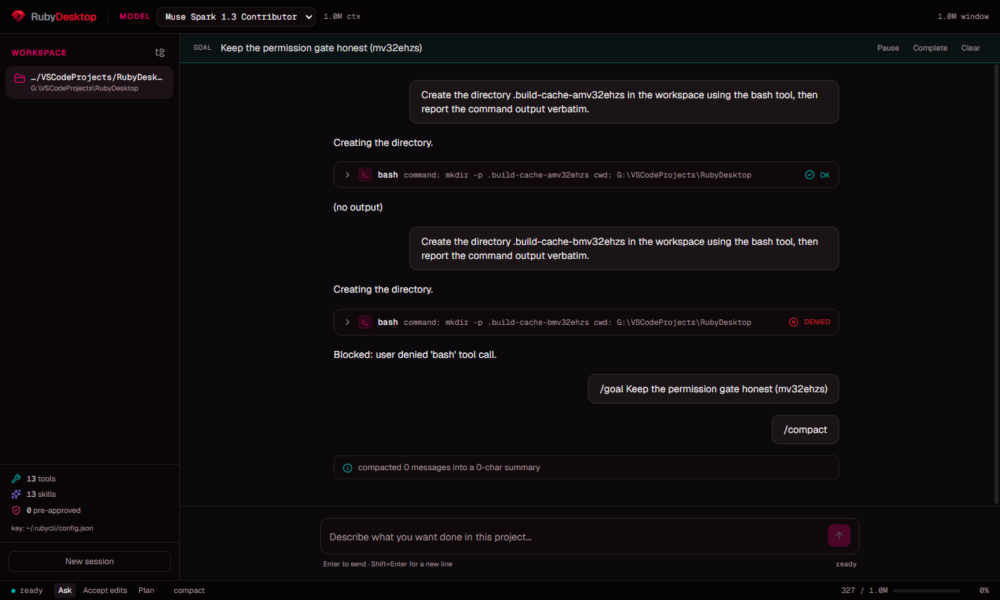

<div align="center">
  
  <h1>Ruby Desktop</h1>
  <p><strong>Um agente de desenvolvimento com o poder do Ruby, direto no seu desktop.</strong></p>
  <p>Converse com modelos, trabalhe em projetos locais e acompanhe cada ação em uma interface feita para construir.</p>
  <p>
    <a href="https://github.com/marcosvkp/RubyDesktop/releases/latest"><strong>Baixar a versão mais recente</strong></a>
    ·
    <a href="https://github.com/marcosvkp/RubyDesktop/issues">Reportar um problema</a>
  </p>
  <p>
    
    
    
  </p>
</div>

<p align="center">
  
</p>

## O que é

Ruby Desktop é um aplicativo de agentes de código para Windows, macOS e Linux. Ele conecta um modelo do catálogo Ruby ao seu workspace para ajudar a entender código, planejar mudanças, editar arquivos e executar tarefas acompanhadas por você.

O aplicativo reúne conversa, ferramentas, permissões, navegador, sessões e métricas em uma interface desktop. As chamadas de modelo passam pelo provider Ruby; o engine do agente é empacotado com o aplicativo, então não é necessário instalar o RubyCLI separadamente para usar uma release.

## O que você pode fazer

| Recurso | Como ajuda |
| --- | --- |
| **Chat com modelos Ruby** | Escolha um modelo do catálogo e acompanhe a resposta enquanto ela é gerada. |
| **Trabalho no workspace** | Peça para explorar o projeto, editar arquivos ou executar comandos; as ações e saídas aparecem na conversa. |
| **Controle de permissões** | Revise solicitações de ferramentas e escolha se o agente pode prosseguir. As decisões de permissão ficam visíveis no fluxo. |
| **Planos e goals** | Organize tarefas, acompanhe progresso e, quando quiser, permita continuações automáticas com limite configurável. |
| **Subagentes** | Delegue exploração ou implementação, escolha modelo e esforço de raciocínio, dê orientações e revise o diff antes de aplicá-lo. Workers trabalham em um Git worktree isolado. |
| **Perguntas interativas** | Responda perguntas do agente no próprio chat, com texto livre, escolha única, múltipla escolha e páginas de perguntas. |
| **Browser integrado** | Abra páginas HTTP/HTTPS em abas próprias e deixe o agente navegar e interagir com a página. |
| **MCP e Skills** | Conecte ferramentas MCP, descubra Skills disponíveis e crie uma Skill de projeto com `/new-skill`. |
| **Sessões e workspaces recentes** | Retome conversas salvas e volte rapidamente aos projetos usados recentemente. |
| **Métricas da sessão** | Consulte turnos, etapas, tokens, cache, uso da janela de contexto e, quando disponível, tempos e velocidade. |

## Instalar

Abra [Releases](https://github.com/marcosvkp/RubyDesktop/releases/latest) e escolha o arquivo da sua plataforma:

| Plataforma | Arquivos |
| --- | --- |
| **Windows** | `Ruby.Desktop-<versão>-win-x64.exe` para x64, `win-arm64.exe` para ARM64 ou `win.exe` universal. |
| **macOS** | Arquivo `.dmg` ou `.zip` para `mac-x64` (Intel) ou `mac-arm64` (Apple Silicon). |
| **Linux** | `.AppImage` ou `.deb` para `amd64`. |

Os instaladores Windows e macOS podem exibir avisos do sistema enquanto os pacotes não tiverem assinatura de código.

### Configurar a chave Ruby

Configure sua chave de API nas configurações do aplicativo. O Ruby Desktop a guarda usando o armazenamento seguro do sistema operacional. Se você já usa o RubyCLI, também pode continuar com a configuração existente em `~/.rubycli/config.json` ou com a variável `RUBY_API_KEY`.

Depois, escolha uma pasta de projeto, selecione um modelo e descreva o que deseja fazer.

## Segurança e controle

- O renderer roda isolado, sem acesso direto ao Node.js ou ao sistema de arquivos.
- A chave de API permanece fora da interface web interna; o engine faz as chamadas ao provider.
- O agente trabalha no workspace escolhido. Solicitações de ferramentas passam pelo fluxo de permissões do aplicativo.
- Subagentes exploradores são somente leitura. Workers usam worktrees próprios, e o diff precisa ser revisado antes de entrar no projeto principal.
- O browser aceita apenas páginas HTTP e HTTPS e roda sem acesso ao filesystem local.

## Desenvolver

O Ruby Desktop é a camada Electron/React; o engine fica no repositório separado [RubyCLI](https://github.com/marcosvkp/rubycli). Para desenvolvimento local, mantenha os dois repositórios lado a lado, pois o Desktop usa `../RubyCLI` como dependência.

Requisitos: Git, Node.js 22 ou superior e npm.

```bash
git clone https://github.com/marcosvkp/rubycli.git RubyCLI
git clone https://github.com/marcosvkp/RubyDesktop.git RubyDesktop

cd RubyCLI
npm ci
npm run build

cd ../RubyDesktop
npm ci
npm run dev
```

Comandos úteis no diretório `RubyDesktop`:

```bash
npm run typecheck   # verifica os processos Node e a interface web
npm run build       # compila o engine, o processo principal e a interface
npm start           # abre o build atual
npm run dist        # gera instaladores para a plataforma atual
```

O engine é executado em um processo Node separado do processo principal do Electron. O renderer recebe apenas a API explicitamente exposta pelo preload. Ao alterar o RubyCLI, rode `npm run build` nele antes de compilar o Desktop.

## Repositórios e documentação

- [Ruby Desktop — código e releases](https://github.com/marcosvkp/RubyDesktop)
- [RubyCLI — engine do agente](https://github.com/marcosvkp/rubycli)
- [CONTEXT.md](CONTEXT.md) — estado do projeto e pontos conhecidos
- [PLANO.md](PLANO.md) — decisões e histórico do plano
- [DESIGN.md](DESIGN.md) — referências e decisões visuais

## Licença

O pacote declara licença MIT em [`package.json`](package.json).
